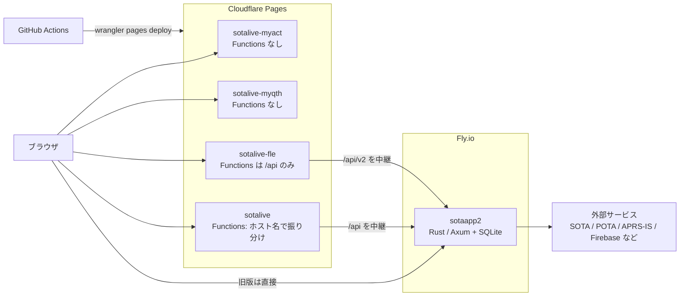

# sotalive-monorepo

SOTA/POTA アマチュア無線アワード支援サービス「sotalive」のフロントエンドをまとめたモノレポ(複数のアプリを1つのリポジトリで管理する形)です。
バックエンド API は別リポジトリの [sotaapp2](https://github.com/jl1nie/sotaapp2)(Rust / Axum、Fly.io)です。

ホスティングは Cloudflare Pages、デプロイは GitHub Actions です。
「GitHub Actions + Cloudflare Pages + Fly.io」の構成を、自分のアカウントで作り直せるように docs/ にまとめています。

## サービス一覧

| URL | 中身 | Pages プロジェクト | 状態 |
|---|---|---|---|
| myact.sotalive.net / www.sotalive.net | MyActivation 旧版(jQuery。`apps/myact-org`) | sotalive-myact | 本番 |
| myqth.sotalive.net | MyQTH 旧版(`apps/myqth-org`) | sotalive-myqth | 本番 |
| fleonline.sotalive.net | FLE Online(React。`apps/fle`) | sotalive-fle | 本番 |
| logconv2.sotalive.net | LogConverter 新版(React。`apps/logconv`) | sotalive | テスト中 |
| myact2.sotalive.net | MyActivation React 版(`apps/myact`) | sotalive | **開発中**(本番は旧版) |
| logconv.sotalive.net | LogConverter 旧版 | Vercel(旧リポジトリ) | 新版のテストが済んだら Pages へ移す |

MyActivation の React 版は開発中です。本番で使われているのは旧版(`apps/myact-org`)です。

## 全体の構成



- 静的ファイルは Cloudflare Pages が配信します。
- `/api/*` は Functions がバックエンドへ中継します(中継先は Pages の環境変数 `BACKEND_URL`。なければ `sotaapp2.sotalive.net`)。旧版の MyActivation・MyQTH は `sotaapp2.sotalive.net` を直接呼びます。
- プロジェクトを4つに分けた理由は [docs/architecture.md](docs/architecture.md) にあります。

## ディレクトリの構成

```
apps/
  myact/        MyActivation の React 版(開発中)        -> dist/myact2
  myact-org/    MyActivation の旧版(jQuery)             -> dist-myact
  myqth-org/    MyQTH の旧版(index.html だけ)            -> dist-myqth
  logconv/      LogConverter 新版(React。WSPR はタブ)    -> dist/logconv
  logconv-org/  LogConverter 旧版の静的ファイル
  fle/          FLE Online(React + Rust 製 wasm)         -> dist-fle/fle
crates/
  fle-core/     FLE 形式の解析・出力(Rust)
  fle-wasm/     fle-core を wasm にする
packages/shared/ 旧版が共有する共通アセット(css, js, img など)
functions/      Cloudflare Pages Functions(プロジェクト sotalive 用)
pages/fle/      FLE プロジェクト用の設定と Functions
scripts/        assemble.sh, build-static-projects.sh
.github/        CI/CD(workflows/ci.yml)と composite action
docs/           ドキュメント
dist, dist-*    ビルドの出力(git 管理外)
```

## 手元で動かす最短の手順

必要なもの: Node 20、pnpm 10、(FLE を動かすなら)Rust と wasm-pack。

```bash
pnpm install
pnpm --filter @sotalive/logconv dev   # http://localhost:3002/logconv/
pnpm --filter @sotalive/fle dev       # http://localhost:3003/fle/ (wasm も作る)
pnpm --filter @sotalive/myact dev     # Vite の既定のポート
```

テストは `pnpm run test`、lint は `pnpm run lint:apps`、全体のビルドは `pnpm run build` です。
詳しくは [docs/development.md](docs/development.md) を見てください。

## ドキュメント

| 文書 | 内容 |
|---|---|
| [docs/architecture.md](docs/architecture.md) | 全体の構成、ホスト名とプロジェクトの対応、リクエストの流れ |
| [docs/development.md](docs/development.md) | 手元での開発、テスト、ビルド |
| [docs/deploy-guide.md](docs/deploy-guide.md) | 自分のアカウントで同じ環境を作る手順 |
| [docs/ci-cd.md](docs/ci-cd.md) | GitHub Actions のワークフロー |
| [docs/backend.md](docs/backend.md) | バックエンド(sotaapp2)と Fly.io |
| [docs/apps/fle.md](docs/apps/fle.md) | FLE Online |
| [docs/apps/logconv.md](docs/apps/logconv.md) | LogConverter |
| [docs/apps/myact.md](docs/apps/myact.md) | MyActivation |
| [docs/apps/myqth.md](docs/apps/myqth.md) | MyQTH |
| [docs/fle-grammar.md](docs/fle-grammar.md) | FLE 形式の文法 |
| [docs/fle-protocol.md](docs/fle-protocol.md) | FLE のコアと画面のあいだの取り決め |

## 関連リポジトリ

- [sotaapp2](https://github.com/jl1nie/sotaapp2): バックエンド API(Rust / Axum)
- sotalive-vercel: 旧フロントエンド(Vercel)。移行が終わったら停止する予定です。

## ライセンス

Apache License 2.0 です。[LICENSE](LICENSE) を見てください。

Copyright 2025-2026 Minoru Tomobe (JL1NIE)
